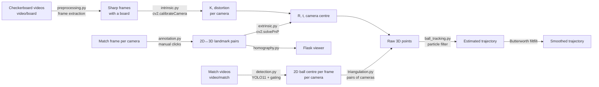

# Multi-View Calibration & 3D Volleyball Tracking

> **Fork note.** This is a documentation fork of
> [pietrolechthaler/MultiViewCalibration-BallTracking](https://github.com/pietrolechthaler/MultiViewCalibration-BallTracking)
> by Ylenia Graziadei and Pietro Lechthaler (University of Trento). The code is unchanged; this README
> expands the original one with a full walkthrough of the idea, the geometry, the machine-learning
> component, the assumptions the system relies on, and the issues found while reading the code.


---

## Table of contents

1. [The idea in one paragraph](#1-the-idea-in-one-paragraph)
2. [The physical setup](#2-the-physical-setup)
3. [Pipeline overview](#3-pipeline-overview)
4. [Stage 1 – Intrinsic calibration](#4-stage-1--intrinsic-calibration)
5. [Stage 2 – Extrinsic calibration](#5-stage-2--extrinsic-calibration)
6. [Stage 3 – Multi-view viewer (homographies)](#6-stage-3--multi-view-viewer-homographies)
7. [Stage 4 – Ball detection with YOLO11 (the ML part)](#7-stage-4--ball-detection-with-yolo11-the-ml-part)
8. [Stage 5 – Triangulation](#8-stage-5--triangulation)
9. [Stage 6 – Particle filter + low-pass smoothing](#9-stage-6--particle-filter--low-pass-smoothing)
10. [Constraints and assumptions](#10-constraints-and-assumptions)
11. [Known issues found in the code](#11-known-issues-found-in-the-code)
12. [Ideas for improvement](#12-ideas-for-improvement)
13. [Repository layout](#13-repository-layout)
14. [Setup and usage](#14-setup-and-usage)
15. [Credits](#15-credits)

---

## 1. The idea in one paragraph

A single camera can tell you *where in the image* a volleyball is, but not *how far away* it is – every
pixel corresponds to a whole ray in 3D. If two or more cameras with known positions and orientations
see the ball at the same instant, their rays intersect (approximately) at the ball's real 3D position.
This project builds that end to end for a real indoor court filmed by **10 synchronized 4K cameras**:
it **calibrates** every camera (lens model + pose in a shared court coordinate frame), **detects** the
ball in each video with a fine-tuned **YOLO11** network, **triangulates** pairs of detections into 3D
points, and finally cleans the noisy cloud of points into a physically plausible trajectory with a
**particle filter** (projectile motion under gravity) followed by a **Butterworth low-pass filter**.

The output is a 3D ball trajectory, in metres, relative to the centre of the court.

---

## 2. The physical setup

### Cameras

| Camera | Approx. real position (x, y, z) in m |
|-------:|:-------------------------------------|
| out1   | (-14.5, -17.7, 6.2) |
| out2   | (  0.0, -17.7, 6.2) |
| out3   | (-22.0, -10.0, 6.6) |
| out4   | ( 14.5, -17.7, 6.2) |
| out5   | (-22.0,  10.0, 5.8) |
| out6   | (  0.0,  10.0, 6.3) |
| out7   | ( 25.0,   0.0, 6.4) |
| out8   | ( 22.0,  10.0, 6.3) |
| out12  | ( 22.0, -10.0, 6.9) |
| out13  | (-22.0,   0.0, 7.0) |

All cameras are mounted ~6–7 m high around the hall and record at **3840×2160, 25 fps**. The
positions above are hand-measured "ground truth" (`calibration/utils/parameters.py →
REAL_WORLD_CAMERA_POSITIONS`) and are only used to visually sanity-check the calibration.

### World coordinate frame

- **Origin**: centre of the volleyball court, on the floor (under the net).
- **X**: along the court length (−9 m … +9 m are the end lines).
- **Y**: along the court width (−4.5 m … +4.5 m are the side lines).
- **Z**: up. The floor is Z = 0. Net height used for drawing: 2.24 m.

### Landmarks

Extrinsic calibration needs points whose 3D position is known. The project uses **36 floor
markings** (`WORLD_LABEL_POINTS`). Points 1–14 and 31–36 are volleyball lines (corners, attack lines
at ±3 m, centre line…). Points 15–30 lie at x = ±14, y = ±7.5 and x = ±8.2, y = ±2.45 / ±1.75: these
are the **basketball court lines painted on the same floor** (a 28 × 15 m FIBA court, its key and
free-throw lines). Using them is a clever trick – they spread the landmarks over a much wider area
than the volleyball court alone, which makes the pose estimate better conditioned.

Every landmark has **Z = 0**, i.e. all calibration points are coplanar (see
[constraints](#10-constraints-and-assumptions)).

---

## 3. Pipeline overview



| Step | Script | Input | Output |
|------|--------|-------|--------|
| Frame extraction | `preprocessing.sh` → `calibration/preprocessing.py` | `video/board/out*F.mp4` | `src-gen/out*F/frame_*.jpg` |
| Intrinsics | `intrinsic.sh` → `calibration/intrinsic.py` | extracted frames | `src-gen/out*F-gen/camera_matrix.txt`, `distortion_coefficients.txt`, `calibration_data.pkl` |
| Landmark annotation | `annotation/annotation.py <cam>` | one match frame per camera | `annotation/annotation-dist/out*-ann.json` (already committed) |
| Extrinsics | `extrinsic.sh` → `calibration/extrinsic.py` | intrinsics + annotations | `src-gen/out*F-gen/calibration_extrinsic.pkl`, 3D camera plot |
| Viewer | `viewer_*.sh` → `viewer/app.py` | annotations | web app on `localhost:5000` |
| Detection | `detection.sh` → `tracking/detection.py <cam>` | `video/match/out*.mp4`, YOLO weights | `tracking/coordinates/out*_coordinates.csv`, annotated video |
| Triangulation | `tracking.sh` → `tracking/triangulation.py` | 2D CSVs + calibration | `tracking/results/coords_3d_all.csv` |
| Tracking | `tracking.sh` → `tracking/ball_tracking.py` | 3D CSV | `estimated_trajectory.csv`, `smoothed_trajectory.csv`, plot |

---

## 4. Stage 1 – Intrinsic calibration

**Goal:** for each camera, find how it maps a 3D point *in its own coordinate frame* onto pixels.

The pinhole model with lens distortion:

```
        [fx  0  cx]
    K = [ 0 fy  cy]        d = (k1, k2, p1, p2, k3)
        [ 0  0   1]
```

- `fx, fy` – focal lengths in pixels, `cx, cy` – principal point.
- `k1, k2, k3` – radial distortion (barrel / pincushion, strong on wide-angle sports cameras).
- `p1, p2` – tangential distortion (lens not perfectly parallel to the sensor).

**How it is done here**

1. `preprocessing.py` reads each calibration video (`video/board/out{N}F.mp4`), keeps one frame
   every `SKIP_FRAMES = 25` (≈ 1 per second at 25 fps), and only if `cv2.findChessboardCorners`
   actually finds the board. The inner-corner grid is `(7,5)` or `(9,6)` depending on the camera;
   squares are `SQUARE_SIZE = 28` mm.
2. `intrinsic.py` ranks those frames by **sharpness** (variance of the Laplacian – blurry frames from
   a moving board have low high-frequency energy) and keeps the `TOP_N = 40` sharpest.
3. Corners are refined to sub-pixel accuracy (`cv2.cornerSubPix`).
4. `cv2.calibrateCamera` (Zhang's method) jointly solves for `K`, `d` and one board pose per image by
   non-linear least squares, minimising the **reprojection error** – the pixel distance between
   detected corners and where the model predicts them. The RMS error is printed and stored in
   `calibration_data.pkl`.

---

## 5. Stage 2 – Extrinsic calibration

**Goal:** place every camera in the shared court frame: rotation `R` and translation `t` such that a
world point `Pw` projects as

```
s · p = K · [R | t] · Pw
```

**How it is done here**

1. A frame from each match video is annotated by hand with `annotation/annotation.py`: a Tkinter
   window asks you to click landmarks 1…36 in order, or to mark them "occluded/missing". Clicks are
   rescaled to the original 4K resolution and saved to `annotation/annotation-dist/out{N}-ann.json`.
   (`annotation-undist/` holds the same points clicked on undistorted images; it is not used by the
   pipeline.)
2. `extrinsic.py` pairs each clicked pixel with its known 3D landmark and calls
   `cv2.solvePnP(world_pts, image_pts, K, dist)` – the **Perspective-n-Point** problem: given ≥ 4
   2D↔3D correspondences and the intrinsics, find the camera pose. OpenCV's default solver is
   iterative Levenberg–Marquardt minimising reprojection error. Distortion coefficients are passed
   in, so the clicked (distorted) pixels are handled correctly.
3. The camera centre in world coordinates is `C = −Rᵀ t`. It is stored together with `Rᵀ` and `t`
   in `calibration_extrinsic.pkl`, and all estimated centres are plotted next to the hand-measured
   ones (`src-gen/camera_positions_3D.png`) as a sanity check.

---

## 6. Stage 3 – Multi-view viewer (homographies)


A small Flask app (`viewer/`) shows a top-down court diagram plus all 10 camera images. Clicking a
spot on the diagram:

1. converts the click from diagram pixels to court metres with a simple linear map
   (`get_world_point`, hard-coded to the diagram's corners);
2. for every camera, estimates a **homography** `H` from the floor plane to the image with
   `cv2.findHomography(..., RANSAC)` using the annotated landmarks;
3. projects the point into every view and draws a marker there.

Because every landmark is on the floor, a homography (a 3×3 plane-to-plane mapping) is enough here –
but it is only valid for points **on the floor** (Z = 0). It is a verification/visualisation tool,
not part of the 3D tracking math. Note that the camera images (`viewer/static/images/out*.jpg`) are
not in the repository and must be added yourself.

---

## 7. Stage 4 – Ball detection with YOLO11 (the ML part)

This is the only learned component. Everything else is classical geometry and estimation.

### Why a neural detector?

A volleyball in a 4K wide shot is small (tens of pixels), moves fast (motion blur), is frequently
occluded by players and the net, and has to be distinguished from heads, lights, logos and spare
balls. Classical approaches (colour thresholding, background subtraction, Hough circles) break
easily under those conditions. A CNN detector learns appearance directly from labelled examples.

### Model

- **Architecture:** Ultralytics **YOLO11n** ("nano"), a single-stage, anchor-free detector. A single
  forward pass predicts, for every cell of several feature maps, a box and a class score; NMS keeps
  the best boxes. Nano is the smallest variant (~2.6 M parameters) – fast inference, at some cost in
  accuracy on tiny objects.
- **Transfer learning:** training starts from COCO-pretrained weights (`yolo11n.pt`; COCO already
  contains a generic "sports ball" class), and is fine-tuned on one class, `volleyball`
  (`tracking/data.yaml`).

### Dataset

From the authors' report: **1,015 frames** labelled with bounding boxes in **LabelImg** (YOLO
format), split ≈ **80 % train / 20 % validation**. The rallies used for the final evaluation were
deliberately **excluded** from the labelled frames to avoid leakage. The dataset itself is not in
the repo (`tracking/datasets` is git-ignored).

### Training (`tracking/train_yolo.py`, run `train6`)

| Hyper-parameter | Value |
|---|---|
| Epochs | 100 (patience 100 → no early stop) |
| Image size | 640 |
| Batch | 16 |
| Optimizer / LR | `auto`, lr0 = 0.01 |
| Augmentation | HSV jitter (h 0.015, s 0.7, v 0.4), rotation ±10°, scale 0.5, horizontal flip 0.5, **vertical flip 0.5**, mosaic 1.0 |

Training took ~46,700 s (≈ 13 h) for 100 epochs, which suggests CPU or a modest GPU.

### Results (best epoch, 86 – from `tracking/runs/detect/train6/results.csv`)

| Metric | Value | What it means |
|---|---|---|
| Precision | **0.971** | When the model says "ball", it is almost always right. |
| Recall | **0.761** | It misses ~1 in 4 balls in validation frames (blur, occlusion, tiny size). |
| mAP@0.5 | **0.833** | Average precision with a lenient 50 % box-overlap requirement. |
| mAP@0.5:0.95 | **0.377** | Much lower under strict overlap – expected for tiny objects, where a 2–3 px box error is a large IoU penalty. |

High precision / lower recall is the right trade-off for this pipeline: a missed detection is
handled later by the particle filter (it just predicts), whereas a false positive becomes a wrong 3D
point.

Training curves, PR/F1 curves, confusion matrices and sample batches are in
`tracking/runs/detect/train6/`. The trained weights are `tracking/runs/detect/train6/weights/best.pt`.

### Inference (`tracking/detection.py`)

For each camera, between `START_SEC = 155` and `END_SEC = 166` of the match video:

1. **Manual ROI.** On the first frame you draw a rectangle (`cv2.selectROI`) around the region
   where the ball will be. Only this crop is fed to YOLO – it removes the crowd and other courts,
   and makes the ball relatively larger once the crop is resized to 640 px.
2. **Detect.** `model.predict(conf=0.30)`, keep the single highest-confidence box (the system
   assumes one ball).
3. **Gate.** The detection is accepted only if
   - confidence ≥ 0.40, and
   - its centre is within `100 px × (1 + 0.5·skipped)` of the previous accepted centre
     (a crude motion gate that widens after misses); after 5 consecutive misses the gate resets.
   - For camera 7 only, a hard-coded pixel box `(1160,900)-(1270,960)` is ignored (a static
     ball-like false positive in that view).
4. **Output** the box centre `(x, y)`, confidence and timestamp (rounded to 0.01 s) to
   `tracking/coordinates/out{N}_coordinates.csv`, plus an annotated video.

`sliding_window_detection()` (tile a large ROI into overlapping 640 × 640 windows to keep full
resolution) is implemented but not used.


---

## 8. Stage 5 – Triangulation

`tracking/triangulation.py`

1. Build each camera's 3 × 4 **projection matrix** `P = K · [R | t]` from the stored intrinsics and
   extrinsics (it rebuilds the 4×4 camera-to-world transform from `Rᵀ` and `C`, inverts it, and
   keeps the top 3 rows).
2. Cameras are processed in **10 fixed neighbouring pairs** forming a ring around the hall:
   3–1, 1–2, 2–4, 4–12, 12–7, 7–8, 8–6, 6–5, 5–13, 13–3.
3. For each pair, detections are **inner-joined on identical timestamp**, i.e. only frames where
   both cameras saw the ball are used.
4. `cv2.triangulatePoints` solves the linear **DLT** system: each view gives two linear equations in
   the homogeneous point `X`; the 4 equations are solved by SVD and the result is de-homogenised.
5. All pairs' points are concatenated into `tracking/results/coords_3d_all.csv`, filtered to the
   [155, 166] s window and sorted by time. A timestamp seen by several pairs therefore produces
   several 3D points.


---

## 9. Stage 6 – Particle filter + low-pass smoothing

`tracking/ball_tracking.py`, `tracking/utils/particle_filter.py`

### Why a filter?

Raw triangulated points are noisy (pixel error is amplified by geometry), sometimes wildly wrong
(a mismatched detection in one camera), and missing during occlusions. A Bayesian filter combines
a **motion model** (what the ball *should* do) with **measurements** (what the cameras say).

### Particle filter

A particle filter represents the belief about the ball state as a cloud of weighted samples.

- **State per particle:** position and velocity (6-D). **1000 particles**, initialised around the
  first detection (σ = 1 m position, σ = 1 m/s velocity).
- **Predict:** constant-velocity motion plus gravity (`−9.81 m/s²` on Z, i.e. projectile motion),
  plus Gaussian process noise (σ = 0.5).
- **Outlier gate:** if a new 3D point is more than **4 m** from the last estimate, it is ignored and
  only the prediction is kept.
- **Update:** each particle gets weight `N(‖p − z‖; 0, σ = 1 m)`; weights are normalised.
- **Resample:** systematic resampling every step (draw particles proportional to weight).
- **Estimate:** weighted mean of particle positions.

Why a particle filter rather than a Kalman filter? It does not need linear/Gaussian assumptions and
can in principle represent multi-modal beliefs (e.g. two candidate balls). For a single ball under
gravity, a (extended) Kalman filter would also work and would be cheaper.

### Butterworth smoothing

The particle-filter output still jitters. A 2nd-order **Butterworth low-pass** (cut-off 5 Hz) is
applied with `filtfilt` (forward + backward pass → zero phase lag), after interpolating any gaps.

The final CSV `tracking/results/smoothed_trajectory.csv` contains detections (`*_det`), filter
estimates (`*_est`) and smoothed path (`*_smooth`).

---

## 10. Constraints and assumptions

The system works on the authors' recordings, but it leans on several assumptions worth knowing
before reusing it:

**Data / environment**
- **Hardware-synchronised cameras.** Frames are matched across cameras by *exact equality* of the
  timestamp rounded to 0.01 s. Any offset between cameras (even one frame = 40 ms ≈ 0.5–1 m of ball
  travel at spike speed) directly corrupts triangulation.
- **Static cameras.** Calibration is done once; if a camera is bumped, its extrinsics are wrong.
- **Known court geometry.** Landmark coordinates are hard-coded for this specific hall (volleyball +
  basketball lines). Another venue needs new landmarks and re-annotation.
- **Videos and dataset are not included.** `video/board/` and `video/match/` only contain
  placeholder READMEs; the YOLO training dataset and the viewer images are also absent. Only the
  trained weights, the annotations and the intermediate CSVs are committed.

**Geometry**
- **All extrinsic landmarks are coplanar (Z = 0).** PnP still works with a plane, but height (Z) is
  less constrained than X/Y, and errors in clicked points affect the camera height/tilt.
- **Pairwise triangulation only.** Each 3D point uses exactly two cameras from a fixed ring of
  neighbours; there is no N-view least-squares fusion, no use of non-adjacent pairs, and no
  reprojection-error check to reject bad pairs.
- **Pinhole projection in triangulation** – see known issues (distortion is not removed from
  detected pixels).

**Detection**
- **Exactly one ball.** Only the top-scoring box per frame is used (no warm-up balls, no training
  drills).
- **Manual step per camera.** You must draw an ROI by hand for each camera every run, so
  `detection.sh` is not unattended.
- **Hard-coded time window** (155–166 s) and a **hard-coded exclusion box** for camera 7.
- **Pixel-based gating** (100 px) is resolution- and distance-dependent.

**Tracking**
- **Offline only.** `filtfilt` uses future samples and the scripts process whole files; nothing here
  is real-time.
- **Single continuous rally.** One filter is initialised from the first detection and never re-
  initialised; ball contacts (hits, bounces) are not modelled – the gravity model is only valid
  between touches, and the process noise has to absorb the impulses.

---

## 11. Known issues found in the code

These were found while reading the code for this README (upstream commit `3068f2c`). They are
documented, not fixed, in this fork.

1. **Particle-filter state layout mismatch (`particle_filter.py`).** Particles are created as
   `[x, y, z, vx, vy, vz]` (`np.hstack([pos, vel])`), but the transition matrix `F` assumes the
   interleaved layout `[x, vx, y, vy, z, vz]`, and gravity is added to columns 4 and 5. In the actual
   layout that means: x is advanced by `y·dt`, z by `vx·dt`, `vy` by `vz·dt`, y is never moved by
   its velocity, and the gravity terms land on `vy` and `vz` instead of `z` and `vz`. The filter still "works" because the measurement
   update dominates (σ_meas = 1 m with resampling every step), but the physics prior is effectively
   wrong. Fix: either interleave the state on construction or rewrite `F` for the block layout and
   apply gravity to indices 2 (z) and 5 (vz).
2. **Lens distortion ignored at triangulation.** Detections are in raw (distorted) pixels, and
   `P = K[R|t]` is a pure pinhole model. Points should be undistorted first
   (`cv2.undistortPoints(pts, K, dist, P=K)`) – especially near the image edges of wide lenses.
3. **Wrong sampling rate in the low-pass filter.** `lowpass_filter` assumes `fs = 100 Hz`, but the
   video is 25 fps (timestamps step by 0.04 s). The real cut-off is therefore ~1.25 Hz, not 5 Hz,
   which over-smooths fast actions. Also the samples are not uniformly spaced (gaps, duplicates).
4. **Duplicate timestamps.** Several camera pairs produce points for the same instant; the PF then
   runs predict with `dt = 0` and multiple updates per frame. In `ball_tracking.py`, the final merge
   on `timestamp` with duplicates creates a Cartesian blow-up – `smoothed_trajectory.csv` has 481
   rows for 263 input points. Averaging (or jointly triangulating) per timestamp would fix both.
5. **Raw 3D outliers are large.** In the committed `coords_3d_all.csv`, Z ranges from about −9 m to
   +68 m, so a few camera pairs/timestamps produce badly wrong points. The 4 m gate in the tracker
   hides this; a reprojection-error test at triangulation time would be more principled.
6. **Docs vs code.** The original README/report mention *bundle adjustment*; the code only runs
   per-camera `solvePnP` – there is no joint multi-camera refinement.
7. **Missing dependencies.** `requirements.txt` lacks `pandas`, `matplotlib` and `Pillow`, which are
   imported by `triangulation.py`, `ball_tracking.py`, `extrinsic.py` and `annotation.py`.
8. **Path assumptions.** Scripts must be run from the repo root (they use relative paths like
   `./src-gen`, `annotation/...`), except `annotation/annotation.py` and
   `annotation/extract_frame.py`, which expect to be run from inside `annotation/`.
   `train_yolo.py` expects `data.yaml` and `yolo11n.pt` in the working directory.
9. **`plt.show()` blocks** `extrinsic.py` and `ball_tracking.py` until the window is closed, so the
   shell scripts are not headless-safe.
10. **`viewer_windows.sh` kills every `python.exe`** on the machine to free port 5000.

---

## 12. Ideas for improvement

- **Multi-view triangulation:** for each timestamp, triangulate from *all* cameras that see the ball
  (linear DLT over N views, then refine by minimising total reprojection error), and reject views
  with high residual (RANSAC over cameras).
- **Bundle adjustment** across all 10 cameras using the shared landmarks (e.g. `scipy.optimize.
  least_squares`), plus some non-floor landmarks (net top, antenna tips, pole tops) to constrain Z.
- **Fix the PF** (issue 1) or replace it with an EKF/UKF on `[p, v]` with gravity, plus a
  hit/bounce detector that inflates process noise or re-initialises at contacts.
- **Detector:** use the existing sliding-window function at full resolution, a larger YOLO11 variant
  (s/m), temporal models (TrackNet-style input of 3 consecutive frames handles motion blur well), and
  hard-negative mining for the camera-7 false positive instead of a hard-coded box.
- **Automate the ROI** (court mask projected from the calibration) so detection runs unattended.
- **Time sync check:** estimate inter-camera offsets from the data (minimise triangulation error
  over candidate shifts).

---

## 13. Repository layout

```
.
├── annotation/                 # landmark annotation tool + annotated landmark JSONs
│   ├── annotation.py           # Tkinter click tool (36 landmarks per camera)
│   ├── check_annotations.py    # draws annotated points on images for verification
│   ├── extract_frame.py        # grab + undistort a match frame for annotation
│   ├── annotation-dist/        # landmarks clicked on raw frames (used)
│   └── annotation-undist/      # landmarks clicked on undistorted frames (unused)
├── calibration/
│   ├── preprocessing.py        # checkerboard frame extraction
│   ├── intrinsic.py            # cv2.calibrateCamera per camera
│   ├── extrinsic.py            # cv2.solvePnP per camera + 3D plot
│   ├── undistortion.py         # CLI: undistort a single image
│   └── utils/                  # parameters (landmarks, cameras, board sizes) + helpers
├── tracking/
│   ├── train_yolo.py           # YOLO11n fine-tuning
│   ├── data.yaml               # dataset definition (1 class: volleyball)
│   ├── detection.py            # per-camera detection + gating → 2D CSV
│   ├── triangulation.py        # camera-pair DLT → 3D CSV
│   ├── ball_tracking.py        # particle filter + Butterworth → trajectory
│   ├── utils/                  # tracking parameters + ParticleFilter class
│   ├── coordinates/            # committed 2D detections and per-pair 3D points
│   ├── results/                # committed 3D results
│   └── runs/detect/train6/     # training logs, curves and weights (best.pt)
├── viewer/                     # Flask multi-view correspondence viewer
├── video/{board,match}/        # place the (not included) videos here
├── report/report.pdf           # the authors' project report
├── readme/                     # images used in this README
└── *.sh                        # entry-point scripts for each stage
```

---

## 14. Setup and usage

Tested by the authors on Windows 11 (Python 3.10.14) and Ubuntu 24.10 (Python 3.12.7).

```bash
git clone https://github.com/NathanNarrik/MultiViewCalibration-BallTracking.git
cd MultiViewCalibration-BallTracking
python -m venv env
source env/bin/activate          # Windows: env\Scripts\activate
pip install -r requirements.txt
pip install pandas matplotlib pillow   # missing from requirements.txt (see issue 7)
```

Put the videos in place (not provided in the repo):

```
video/board/out{1,2,3,4,5,6,7,8,12,13}F.mp4   # checkerboard calibration videos
video/match/out{1,2,3,4,5,6,7,8,12,13}.mp4    # synchronized match videos
```

Then run each stage from the repository root (on Windows use Git Bash or run the Python commands
directly):

```bash
./preprocessing.sh     # extract checkerboard frames → src-gen/
./intrinsic.sh         # intrinsics → src-gen/out*F-gen/
./extrinsic.sh         # extrinsics (uses committed annotations) + camera plot
./detection.sh         # YOLO detection; draw an ROI for each camera when prompted
./tracking.sh          # triangulation + particle filter + smoothing → tracking/results/
./viewer_linux.sh      # or viewer_windows.sh → http://127.0.0.1:5000/
```

Parameters live in `calibration/utils/parameters.py` (board sizes, landmarks, camera list) and
`tracking/utils/parameters.py` (weights path, time window, camera pairs, court dimensions).

To retrain the detector, prepare a YOLO-format dataset under `tracking/` matching `data.yaml`
(`images/train`, `images/val`, `images/test` + `labels/...`), then:

```bash
cd tracking && python train_yolo.py
```

---

## 15. Credits

Original work: **Ylenia Graziadei** and **Pietro Lechthaler**, Department of Information Engineering
and Computer Science, University of Trento – see `report/report.pdf` and the
[upstream repository](https://github.com/pietrolechthaler/MultiViewCalibration-BallTracking).

References used by the authors: OpenCV camera calibration docs; Zhang, *Camera calibration*;
Ultralytics YOLO11; Tzutalin, *LabelImg*; Cho et al., *A real-time object tracking system using a
particle filter* (IROS 2006).

This fork only adds documentation.
